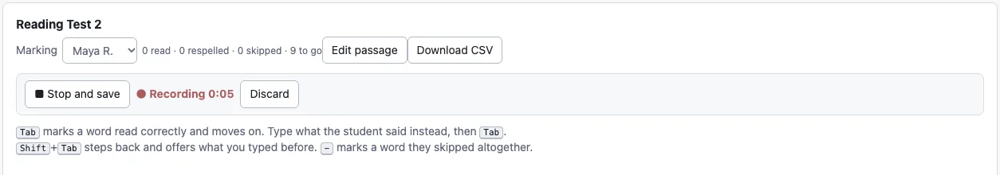
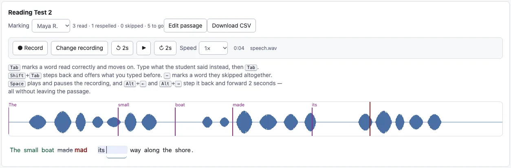
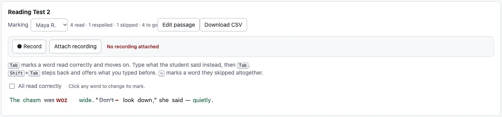

# Reading a passage aloud

A spelling test asks *you can hear /ā/, can you write `ai`?* A reading test asks
the same question the other way round: *you can see `ai`, can you say /ā/?*

Those are different skills, and a student can be fine one way and lost the
other. Spelling is **encoding**; reading aloud is **decoding**. This page is
where you record the second one.

## Start a reading test

**New reading test** in the toolbar makes one, next to **New spelling test**.
Reading tests sit in the same list as your spelling tests and are named
*Reading Test 1*, *2* and so on, so the dropdown tells you which is which.

The tab strip follows whichever test you have chosen: pick a reading test and
**Spelling test** is replaced by **Reading passage**. There is only ever one
entry page on offer, and it is the one that fits the test you are on.

## Paste the passage

Paste in whatever the student is going to read. Punctuation, quotation marks and
paragraph breaks all come back exactly as you pasted them, so the passage on
screen looks like the passage in their hand.

Two things are worth knowing about how the text is broken into words:

- **Numerals are skipped.** There is no one way to read `1953` aloud, so there
  is nothing to check it against. Spell numbers out if they matter.
- **Hyphenated words count as two.** `well-known` is marked as `well` and
  `known`, because that is how it is read.

## Record the student, or attach a recording you already have

### Recording here

**● Record** records through your computer's microphone. The browser asks
permission the first time; after that, press Record, let the student read, and
press **Stop and save**.

It then asks where to put the file, and that is the only copy — it is written
straight to the folder you choose, not kept inside the app. **Discard** throws a
recording away without saving it.

While it is recording, the red **● Recording** counter is on screen the whole
time and the microphone is released the moment you stop. A page that can listen
to a child should never leave you guessing whether it is.

### Check the level bar before you rely on it

Next to the counter is a small bar that moves with the sound coming in. **If it
is not moving, nothing is being recorded.**

This matters more than it sounds. A browser can open the *wrong* microphone —
the virtual one belonging to Zoom, Teams, or an audio tool you installed once —
and that device opens perfectly happily and then delivers pure silence. Your
computer shows the microphone as active, the recording appears to work, the file
saves, and it contains nothing at all.

So the app watches for it. If no sound arrives for a couple of seconds it says
so in red while you are still recording, and if a whole recording turns out to
be silent it tells you after saving rather than letting you find out later.

**Mic** lets you choose which microphone to use. If the level bar is dead, that
is the first thing to change. The choice is remembered on this computer — it is
not stored in your project, because a microphone that exists on your laptop will
not exist on anyone else's.

A silent recording is still saved rather than thrown away. If the app were wrong
about it, deleting it would destroy the only copy of something that cannot be
recorded again.

Recording here saves a round trip: no mailing a file to yourself from your
phone, no hunting through Downloads, and no copy of a student's voice sitting in
your email.

### Attaching one you already have

**Attach recording** takes `.mp3`, `.m4a`, `.wav` and the `.mov` files phones
produce.

**Speed** is the control that earns its place — most people mark comfortably at
0.75×. **↺ 2s** and **↻ 2s** step the recording back and forward two seconds.

### Finding your place in the recording

Under the controls the recording is drawn out as a waveform. It is there because
scrubbing a plain progress bar means overshooting and scrubbing back, over and
over, and the thing you want is usually one particular word.

- **Click anywhere on it** to move the recording to that moment.
- **The vertical marks are the words you have already stepped through**, in the
  places you heard them. Hover one to see which word it is.
- **Click a mark** and the recording goes back to that word *and* the cursor
  moves to it, so you can listen again and change what you wrote.
- The silences between sentences show up as flat stretches, which turn out to be
  the easiest things to navigate by.

The marks appear as you work: each <kbd>Tab</kbd> notes where you were, so the
bar fills in behind you.

If a recording cannot be drawn — some phone video files will not decode this way
even though they play perfectly — the bar becomes a plain timeline instead. It
still shows the word marks and still takes a click.

### It remembers where you were in the recording

Each time you press <kbd>Tab</kbd>, the app notes where you are in the audio. So
when you press <kbd>Shift</kbd>+<kbd>Tab</kbd> to go back a word, **the
recording goes back with you** and plays that word again. Step back three words
and it rewinds three words. You can listen to something twice without hunting
for it on a scrubber.

It starts playing slightly before the word, because you always tap a moment
after a word begins.

### The recording stays on your computer

The app notes *where your file is*, not the file itself. Your project `.json`
holds the times — a few numbers per word — and nothing else; a recording would
be megabytes and would break the automatic save.

That has one consequence worth knowing: **the recording is not carried inside
your project file.** Open the file on another computer and the marks are all
there, but you will be asked for the recording again. In Chrome and Edge the app
remembers which file it was and reconnecting is one click.

If you attach a *different* file from the one the times were made against, it
says so rather than quietly seeking to the wrong places.

### Why it cannot listen for you

It would be better if the app could hear the recording and mark it itself. It
cannot, for two reasons that are not going to change soon:

- The smallest speech model worth using is about twice the size of this entire
  application, which is one file you can email to someone.
- The speech recognition built into browsers **sends the audio to a company's
  servers**. That would break the promise on the About page that nothing you put
  into this page ever leaves your computer — and a recording of a child reading
  is the last thing that should.

So the app plays, remembers your place, and keeps out of the way. You do the
listening.

## Mark it while you listen

Pick the student you are listening to, then work through the passage from the
keyboard. You should not need the mouse at all.

| Key | What it means |
|---|---|
| <kbd>Tab</kbd> | They read that word correctly — move to the next |
| type, then <kbd>Tab</kbd> | They said this instead |
| <kbd>Shift</kbd>+<kbd>Tab</kbd> | Go back a word |
| <kbd>-</kbd> | They skipped that word altogether |
| <kbd>Alt</kbd>+<kbd>←</kbd> / <kbd>Alt</kbd>+<kbd>→</kbd> | Step the recording back or forward two seconds |

<kbd>Alt</kbd> is used for the recording controls on purpose. Every unmodified
key is already spoken for — letters are the respelling, <kbd>Tab</kbd> advances,
and the plain arrow keys still move the cursor inside a respelling you are
correcting. You can step the audio without ever leaving the passage.

**Most words are read correctly, so most of the time this is just
<kbd>Tab</kbd>.** You only type when something goes wrong.

### Type what it sounded like

When a student misreads a word, write down **what you heard, spelled the way it
sounded**. If they read *chasm* as "cham", type `cham`. If they read *made* as
"mad", type `mad`.

You do not need any special alphabet — ordinary letters are exactly right. The
app works out the sounds from your spelling, the same way it works out the
sounds of a student's spelling on a spelling test.

### Going back

<kbd>Shift</kbd>+<kbd>Tab</kbd> steps back to the word before. If you had
already typed something for it, **it comes back ready to go**: press
<kbd>Tab</kbd> to confirm it as it stands, or just start typing to replace it.

Going backwards never marks anything. You can move back through a sentence to
check what you heard without the app deciding those words were read correctly.

### Skipped words

<kbd>-</kbd> on a word nobody has said anything about marks it as skipped — the
student left it out rather than getting it wrong. It shows struck through with a
red dash; click the dash to undo it.

A skipped word is not scored as a decoding mistake, because there is no way to
tell *which* part of the word defeated them. It is recorded so the count at the
top of the page stays honest.

## Editing the passage afterwards

**Edit passage** lets you change the text after you have started marking. Marks
stay on the words you keep — only the words you remove, or change into different
words, lose theirs. The app tells you how many marks are on the passage before
you start.

If you have locked the word list (the same **🔒** lock the spelling grid uses),
the passage cannot be edited at all until you unlock it.

## Checking the analysis

Once a passage is marked, the **Grapheme analysis** tab breaks it down the same
way it breaks down a spelling test: one column per spelling unit, with the sound
it makes underneath, and a colour for how each student handled it.

The question it asks is the other way round, though, and the wording follows.
The column headed *Wrote* on a spelling test is headed **Said** here, and amber
no longer means "right sound, different spelling" — a reader never chooses a
spelling. It means **accent, not a decoding error**.

### Spelling the sounds is not the same as making them

This is the part worth understanding, because it is why a reading test needs its
own scoring.

Suppose a student reads *cliff* perfectly and you write down `clif`. On a
spelling test, `f` for `ff` is a real decision and the app marks it amber. But
your student never made that decision — they said /f/, correctly, and `clif` is
just how you wrote it down. So on a reading test it is **green**.

The same goes the other way. If they read *shore* as "sore", that is a digraph
reduced to its first letter, and it is marked wrong whichever way you transcribe
it. Real misreadings survive; your choice of letters does not count against
anyone.

**So spell what you heard however comes naturally.** You are not being marked on
your spelling.

### When the app gets it wrong

Accents are where an automatic judgement will disagree with you, and the app
knows only a few — the cot/caught merger, dropped r's, *-in'* for *-ing*. If a
student's pronunciation is fine and the app has called it wrong, **click the
cell and correct it**. Your decision wins and stays put.

## What happens to the results

The grapheme analysis works now. The **reports** do not include reading tests
yet: they would pool decoding with spelling and average two different questions
into one meaningless number.

The next piece of work adds a switch between the two, and after that two reports
that put them side by side — where a student is weak at both, and where they can
read a word they cannot spell. Marking passages now means that data is ready and
waiting.
