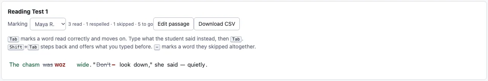

# Reading a passage aloud

A spelling test asks *you can hear /ā/, can you write `ai`?* A reading test asks
the same question the other way round: *you can see `ai`, can you say /ā/?*

Those are different skills, and a student can be fine one way and lost the
other. Spelling is **encoding**; reading aloud is **decoding**. This page is
where you record the second one.

## Start a reading test

**New reading test** in the toolbar makes one, next to **New spelling test**.
Reading tests sit in the same list as your spelling tests and are named
*Reading Test 1*, *2* and so on, so the dropdown tells you which is which.

The tab strip follows whichever test you have chosen: pick a reading test and
**Spelling test** is replaced by **Reading passage**. There is only ever one
entry page on offer, and it is the one that fits the test you are on.

## Paste the passage

Paste in whatever the student is going to read. Punctuation, quotation marks and
paragraph breaks all come back exactly as you pasted them, so the passage on
screen looks like the passage in their hand.

Two things are worth knowing about how the text is broken into words:

- **Numerals are skipped.** There is no one way to read `1953` aloud, so there
  is nothing to check it against. Spell numbers out if they matter.
- **Hyphenated words count as two.** `well-known` is marked as `well` and
  `known`, because that is how it is read.

## Mark it while you listen

Pick the student you are listening to, then work through the passage from the
keyboard. You should not need the mouse at all.

| Key | What it means |
|---|---|
| <kbd>Tab</kbd> | They read that word correctly — move to the next |
| type, then <kbd>Tab</kbd> | They said this instead |
| <kbd>Shift</kbd>+<kbd>Tab</kbd> | Go back a word |
| <kbd>-</kbd> | They skipped that word altogether |

**Most words are read correctly, so most of the time this is just
<kbd>Tab</kbd>.** You only type when something goes wrong.

### Type what it sounded like

When a student misreads a word, write down **what you heard, spelled the way it
sounded**. If they read *chasm* as "cham", type `cham`. If they read *made* as
"mad", type `mad`.

You do not need any special alphabet — ordinary letters are exactly right. The
app works out the sounds from your spelling, the same way it works out the
sounds of a student's spelling on a spelling test.

### Going back

<kbd>Shift</kbd>+<kbd>Tab</kbd> steps back to the word before. If you had
already typed something for it, **it comes back ready to go**: press
<kbd>Tab</kbd> to confirm it as it stands, or just start typing to replace it.

Going backwards never marks anything. You can move back through a sentence to
check what you heard without the app deciding those words were read correctly.

### Skipped words

<kbd>-</kbd> on a word nobody has said anything about marks it as skipped — the
student left it out rather than getting it wrong. It shows struck through with a
red dash; click the dash to undo it.

A skipped word is not scored as a decoding mistake, because there is no way to
tell *which* part of the word defeated them. It is recorded so the count at the
top of the page stays honest.

## Editing the passage afterwards

**Edit passage** lets you change the text after you have started marking. Marks
stay on the words you keep — only the words you remove, or change into different
words, lose theirs. The app tells you how many marks are on the passage before
you start.

If you have locked the word list (the same **🔒** lock the spelling grid uses),
the passage cannot be edited at all until you unlock it.

## What happens to the results

Nothing yet. **Reading tests are not analysed in this version** — they are not
offered in the test picker on any report, and they do not appear in any score.

That is deliberate rather than unfinished. Scoring a reading test means asking a
different question of every sound, and the reports that put reading and spelling
side by side are being built next. Marking a passage now means the data is ready
and waiting when they arrive, rather than being scored by the wrong rules in the
meantime.
