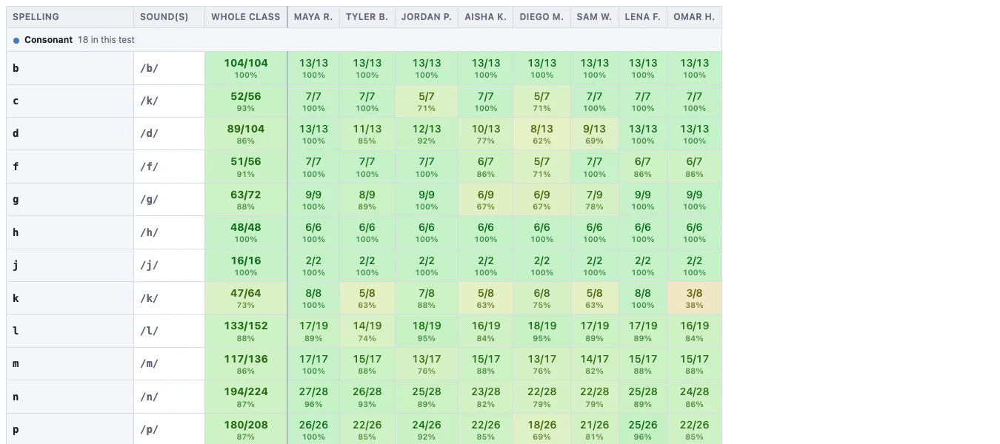
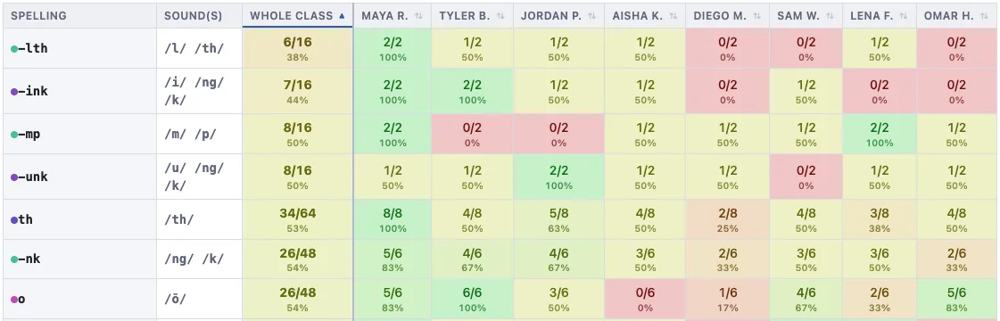

# Accuracy by grapheme

The first of the two **By spelling** reports. It answers one question: *how often
did each spelling get written correctly?*

Every row is one grapheme — `sh`, `ck`, `oa`, `-ttle` — with a column per student
and the **whole class** column first, so you can read the class position before
the individuals.

The rows are grouped under the phonics categories, so a whole category reads at a
glance. Patterns that span several columns, like the `dw` in *dwell*, 
get a row of their own too, and count as correct only when every column 
they cover is correct.

## It pools across whatever tests you choose

The test picker at the top works exactly as it does on the student profile. Click
chips to add or remove tests, or use **Select all**, **Last 3**, **First 3** and
**Most recent**.  More tests will add more data and make differences more 
statistically valid, but averaging over larger time periods can obscure growth.

## Sorting to find the worst

The sheet is laid out in teaching order, which is the right way to read it when
you are planning and the wrong way when the question is *what is this class
worst at* — that answer is scattered down the page.

**Click a column heading to sort by it.** The first click puts the worst first,
which is usually the one you want. Click again for the best first, and a third
time to put the sheet back in teaching order.

- Sort by **Whole class** for what to reteach to everyone.
- Sort by **a student's column** for what that child needs, which can be a very
  different list from the class's.

Two things worth knowing:

- **Sorting breaks the category headings**, because sorting inside each category
  would leave the worst spellings scattered exactly as before. Each row carries
  its own coloured category dot instead, so you can still see what kind of
  pattern it is.
- **Spellings that never came up sink to the bottom** whichever way you sort. A
  blank is the absence of a score, not a bad one, and letting it lead a
  "worst first" list would bury the real answer.

When two rows have the same percentage, the one with more attempts behind it
comes first — twenty attempts is a firmer finding than two.

The CSV and the printout come out in the order on screen, so a sorted sheet
exports sorted.

## Counting amber

The tick box **Count "right sound, different spelling" as correct** decides what
this report is measuring.

- **Unticked:** only exact spellings count.
- **Ticked:** amber counts as correct, and the report becomes a measure of
  hearing the sounds rather than spelling them.

The setting is shared with the by-sound reports, so if you tick it here you will
find it ticked over there too.

## Click any score for the examples behind it

As on the other pages, each individual cell is clickable to get the examples 
behind that number.
