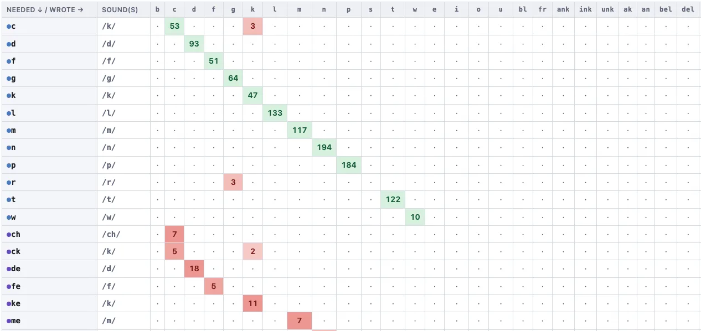
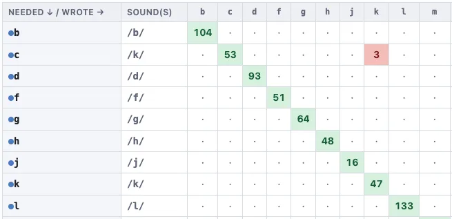

# Grapheme confusion

Accuracy tells you *that* a spelling went wrong. This tells you *what went in
its place*.

## Reading the grid

It is a grid of needed against written, and the header says which way round:
**Needed ↓ / Wrote →**.

- **Rows** is the spelling the word needed.
- **Columns** is what the student rote. Err, I mean wrote. 

Where the two agree you are on the **shaded green diagonal**: the spelling that
was needed is the spelling that appeared. Everything off the diagonal is a
substitution, shaded **red** and marked with the number of times it happened.

A column marked **∅** means nothing was written for that unit at all. 

So a `7` where the row is `ck` and the column is `k` reads: *seven times, a word
needed `ck` and the student wrote `k`.* 

### Two views of the same grid

The tick box under the grid decides how much of it you see.

**Ticked — hide rows and columns with no confusions.** Only the spellings that
were actually mixed up with something are left. A spelling that was always
written correctly has nothing to teach against, so it goes. This is what you
want once a term of tests has made the grid wide: on the demo class it takes a
71-by-83 grid down to 58 by 38.

**Unticked.** Every spelling gets a row *and* a column of its own, in the same
order, so the correct answers run down the green diagonal and you can see what
went right alongside what went wrong.

The **Showing** dropdown switches between the whole class and any individual.

## Click any cell for the examples

As with other pages, every cell with a number in it is clickable to get the 
specific examples under the number.

You might find drilling into the different examples along a row or column
and comparing the correct and incorrect cases to be useful. 

As everywhere else, the window has its own **Download CSV**.

## Pooling tests

The test picker at the top works as it does everywhere else. Confusions are
exactly the kind of thing that needs pooling: a single test might show one `ck`
→ `k`. 
